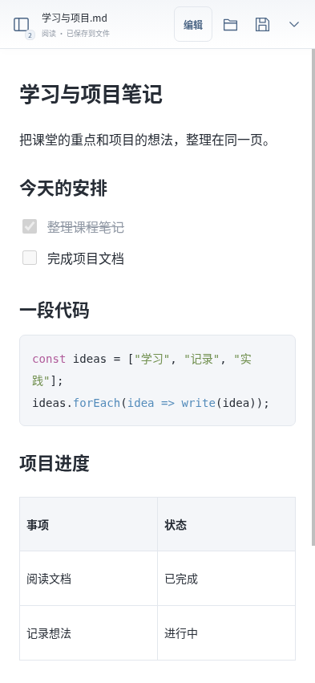
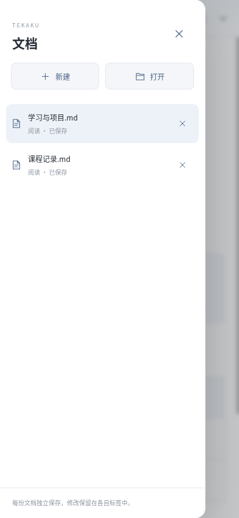

# 手书 Android 0.2.0

轻量的 Android Markdown 编辑器，使用系统 WebView，不随包携带完整浏览器。APK 约 240 KB；这是下载体积，不是安装后占用或运行内存。

## 安装与打开文件

- 适用于 Android 8.0 及以上，系统 WebView 需更新至该系统可用的较新版本。纯 Java 与网页资源，没有 CPU 专属原生库。
- 从官网下载 APK 后，按系统安装提示安装。该版本为仓库直接分发的 APK，未上架 Google Play。
- 点击顶部文件夹图标，通过系统文件选择器打开 `.md`、`.markdown` 或 `.txt`，支持多选。也可以从文件管理器选择“用手书打开”，或分享一份/多份文件或文本给手书。
- 已有文件和恢复草稿默认进入阅读模式；点击顶部“编辑”开始修改，再点“阅读”切回。阅读时可选择、复制和查看只读源码，不能直接修改内容或勾选待办。新建空白文档直接编辑。
- 默认空白首页与白色皮肤；编辑模式底部提供格式按钮和“＋”插入菜单（标题、列表、待办、代码、引用、表格、图片等）。空段落提示只在当前段落出现一次，阅读时不显示。
- 支持 UTF-8（含 BOM），单篇文档上限 2 MiB。代码语言、实时 Markdown 与桌面版共用同一编辑核心，支持同一区域切换源码。

## 多文档抽屉

- 左上角按钮显示已打开文档数量，点击展开侧边抽屉；可新建、打开、切换和关闭标签。点击背景、关闭按钮或系统返回键收起，切换带滑入/滑出动画并遵循减少动态效果设置。
- 每个标签保留独立内容、修改标记、保存目标、阅读/编辑模式、源码状态、富文本撤销记录和滚动位置。标签之间共用一个编辑器和 WebView，不各自加载浏览器。
- 已打开的同一 URI 再次收到时切回原标签，保留修改；不同 URI 即使文件同名也使用独立标签。关闭有修改的标签时可保存、不保存或取消，取消保存不会关闭标签。
- 单篇仍限 2 MiB；原生会话最多保留 64 份文件标识，全部草稿序列化合计限 16 MiB。标签内容和撤销记录会占用内存，较多或较大文档建议及时保存并关闭。





## 保存与草稿

- 顶部保存按钮使用当前标签的独立原生标识，写入对应已授权文件。文件只读或没有写入授权时，打开系统“另存为”窗口；另存为结果只绑定发起保存的标签。
- 阅读模式下，未修改且已绑定文件的标签点击保存不会重写原文；有修改仍可保存，未绑定草稿和另存为仍可选位置。
- 更多菜单提供新建、另存为、源码、四种皮肤和恢复副本。取消保存或取消文件选择时保留当前修改。
- 覆盖已有文件前，先将原文保存为一份应用私有副本；这是全局最近一次写入前的副本，恢复时打开为新标签，不覆盖当前文档。系统文件提供程序不支持可定位写入时，请另存为到本机文件夹。
- 停顿约 550ms 合并写入全部标签的本机草稿，切换到后台也请求保存；恢复时各标签默认阅读，未保存内容仍保留。兼容 0.1 单文档草稿迁移；原文件只有仍获系统读取授权时才重新绑定，否则恢复为需另存为的草稿。草稿不等于已保存原文件，请主动保存。
- 系统返回键先关闭抽屉、菜单或弹窗；退出时逐个检查所有标签的未保存修改，可保存、不保存或取消。
- 草稿和写入前副本位于 Android 应用私有目录；卸载应用会删除这些数据。系统文件选择器保存到外部目录的原文件不属于应用私有草稿。

## 图片、权限与支持范围

- 选择本地 PNG、JPEG、GIF 或 WebP 图片，单图上限 1 MiB、1600 万像素。图片以内嵌 data URI 写入 Markdown，方便单文件携带；会计入 2 MiB 文档上限。
- 只选择一个 Markdown 文件不会同时授予其目录的读取权限，因此暂不自动加载相对路径附件；可以重新选择图片插入。网络图片仅支持 HTTPS，需要网络。
- 使用系统 Storage Access Framework，只访问用户选择并授权的文件；不申请所有文件访问或广泛存储权限。声明的 INTERNET 权限用于网络图片，编辑和保存可离线使用；没有账号、统计或文档上传服务。
- 公式、Mermaid 渲染、脚注和 front matter 专用编辑仍不支持。复杂 Markdown 建议先另存为并核对内容。

## 构建与签名

构建环境为 Linux x64（或 WSL）、Node.js 24、Java 21 JDK、Python 3 和 curl：

```sh
npm ci
npm run setup:android
npm run package:android
```

SDK 构建工具 35.0.0 和 Android 35 平台来自 Google 官方地址；归档 SHA-256 固定在 `scripts/setup-android.mjs`。使用 AAPT2、javac、D8、zipalign 和 apksigner，不依赖 Gradle 或 AndroidX。

第三方许可随 APK 的 `assets/THIRD_PARTY_NOTICES.txt` 一同分发；发布分支也提供可直接阅读的许可文件。

签名库由构建脚本首次生成，保存在仓库外 `/workspace/.tekaku-signing/`，可通过 `TEKAKU_ANDROID_SIGNING_DIR` 指定目录。此私有目录与密码文件均未上传 GitHub；后续兼容升级必须保留并私下备份相同签名材料。公开证书 SHA-256：

```text
6515f68158791ac3ff8bbe181174e817facf4eb41a22d96b8832fc8985489ba3
```

版本代码为 2，应用 ID 仍为 `com.tekaku.mobile`，与 0.1.0 使用相同签名。直接覆盖安装可保留私有草稿；请勿先卸载。APK 通过 v2/v3 签名校验。发布分支附有 APK SHA-256、签名、包信息和检查记录。

## 验证边界

完成 Android SDK 编译、APK 签名与清单校验，12 项 Chromium 触屏尺寸及模拟原生桥接检查通过，覆盖阅读/编辑隔离、单提示、多标签切换/保存、草稿恢复、重复打开、分享队列、关闭取消与退出检查。云环境没有 Android 真机，也没有可用的 KVM 加速；尚未完成 Android 实机安装、软键盘、系统文件选择器、各品牌文件提供程序和实际内存测试。浏览器测试不能替代这些实机验收。
