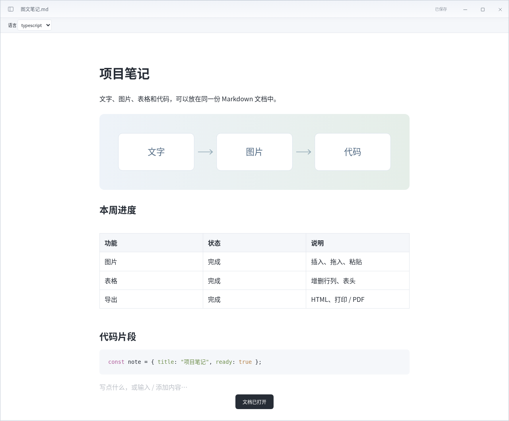

# 手书 Tekaku 0.5.0 · Windows 图文编辑版

[下载 Windows x64 便携包](https://github.com/Linkyyy/tekaku/raw/refs/heads/downloads/windows-v0.5.0/Tekaku-0.5.0-windows-x64.zip)

解压后运行 Tekaku.exe，支持 Windows 10/11 x64，需要系统 Microsoft Edge WebView2 Evergreen Runtime。不需要安装 Go、Node.js 或 .NET。程序本体约 4.3 MiB。包内附有“示例/图文笔记.md”和附件，可直接打开体验。

## 新功能

- 图片：本地选择、多图拖入、剪贴板粘贴、网络图片和相对路径；可编辑图片替代文字和删除。
- 保存时将新图片提取到同名 .assets 目录并按内容去重，另存为到新目录会复制相对图片。移动文档请携带附件目录。遇到同名不同内容图片不会覆盖用户文件。
- GFM 表格：添加/删除行列、切换表头、调整界面列宽。
- 链接文字和地址编辑、系统浏览器打开链接；常用语言代码高亮及语言切换、文字高亮。
- 文档大纲与跳转、查找与替换（含大小写、上/下项、单次/全部替换和源码模式）。
- HTML 导出（本地图片内嵌）、系统打印/PDF；打印时隐藏菜单并使用白底。

入口在侧栏“插入”和“工具与导出”中；Ctrl+F 查找，Ctrl+H 替换，Ctrl+K 链接，Ctrl+Shift+I 图片，Ctrl+P 打印。仍保留四种皮肤、字号/行距/宽度设置、默认全屏和收起侧栏。

支持 PNG/JPEG/GIF/WebP/BMP/SVG/AVIF，单图上限 5 MiB。相对图片需位于文档目录内，外部图片请用文件选择重新插入。浏览器开发模式直接导出 data URI；Windows 桌面模式保存时提取附件。网络图片需要网络，HTML 导出保留网络图片引用。

22 项界面场景和 8 项文件逻辑测试通过，Windows 交叉编译通过；原生文件/打印对话框、剪贴板和拖入的 Windows 系统交互仍需实机复核。程序尚未签名。公式排版、Mermaid 渲染、脚注和 YAML 元数据专用编辑尚未加入；复杂文档建议先另存为。

## 图文编辑示例

## 校验

PowerShell：`Get-FileHash .\Tekaku-0.5.0-windows-x64.zip -Algorithm SHA256`，与 SHA256SUMS.txt 对比。
