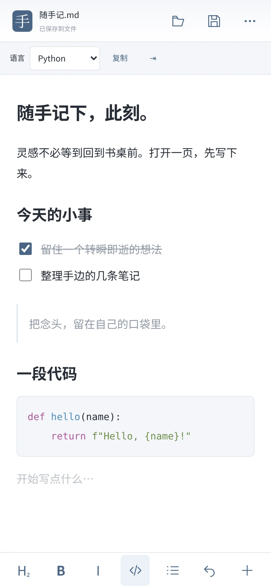

# 手书 Android 0.1.0

[下载 APK（约 235 KB）](https://github.com/Linkyyy/tekaku/raw/refs/heads/downloads/android-v0.1.0/Tekaku-0.1.0-android.apk)

适用于 Android 8.0+，请更新系统 WebView。使用系统浏览器内核，不随包携带完整浏览器；APK 大小不是内存占用。

支持系统选择文件、“用手书打开”或分享 Markdown，实时编辑、源码、代码高亮、列表、图片、表格、四种皮肤。可写文件直接保存；只读或缺少持续授权时另存为。私有草稿与写入前副本只保留在本机。

[完整使用说明与限制](ANDROID.md) · [安全与测试记录](RELEASE-CHECK.md) · [原始检查输出](checks/) · [对应源码快照](https://github.com/Linkyyy/tekaku/tree/bc2af79604ed759e74de02236da7024341b0134f)

## 校验与验证边界

- APK SHA-256：`1f56340461b7805f57674636a32e10d6b049633de7ada106368367c18ddcacdc`
- 发布证书 SHA-256：`6515f68158791ac3ff8bbe181174e817facf4eb41a22d96b8832fc8985489ba3`
- APK v2/v3 签名验证通过；第三方许可已包含在 APK 的 assets/THIRD_PARTY_NOTICES.txt。
- 6 项触屏尺寸界面/模拟原生桥接测试通过；生产页面与 APK 资源逐字节对应。
- 最终 APK、Windows EXE / SDK DLL / ZIP 的 ClamAV 扫描均未检出。单一引擎未检出不等于绝对安全保证。
- 尚未在 Android 真机验收安装、软键盘、系统文件选择器和不同厂商文件读写；未实测内存。文档上限 2 MiB，图片上限 1 MiB，相对图片附件暂不自动解析。
