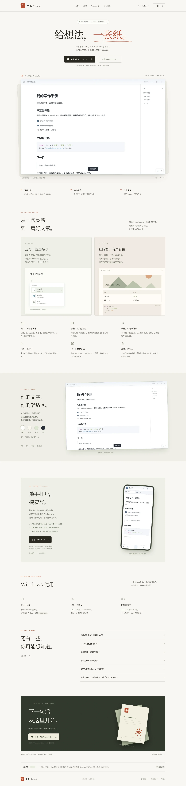

# 手书 Tekaku · 官网

手书 Windows 与 Android 编辑器的中文产品官网。

纯静态 HTML / CSS / JavaScript，**没有构建步骤、运行依赖、外部字体、追踪脚本或账号功能**。图片均随站点提供；四种编辑器皮肤预览来自实际软件界面的浏览器渲染截图。界面功能示意已明确标注。

## 预览



直接打开 `index.html`，或在本目录运行任意静态文件服务器：

```sh
python3 -m http.server 8080
```

打开 `http://localhost:8080`。适配桌面、平板、手机，支持键盘访问和减少动态效果设置。不需要 npm install。

## 部署到 Vercel

[一键部署到 Vercel](https://vercel.com/new/clone?repository-url=https%3A%2F%2Fgithub.com%2FLinkyyy%2Ftekaku%2Ftree%2Fgh-pages&project-name=tekaku-website&repository-name=tekaku-website)

链接明确使用 **gh-pages 官网分支**，避免导入仓库默认的旧版 Windows 下载分支。登录 Vercel 后，按页面提示创建你账户下的 `tekaku-website` 仓库和项目，再点击 Deploy。部署成功后，Vercel 会显示实际的 `.vercel.app` 访问地址。

已提供 `vercel.json`：不安装依赖、不执行构建，直接发布当前目录的静态文件。无需配置环境变量或密钥。

如果希望直接关联原仓库而不创建新仓库，在 Vercel 导入 `Linkyyy/tekaku`，将生产分支设为 **gh-pages**，Root Directory 保持仓库根目录，Framework Preset 使用 **Other**，然后部署。这里的仓库根目录已经是官网，不要再填写 `website`。

本地开发仓库中的 `website/` 对应远程 gh-pages 分支的根目录；如果用 Vercel CLI 从本地部署，请在 `website/` 目录运行 `vercel --prod`，并使用你自己的 Vercel 登录授权。

## GitHub Pages（可选）

官网文件位于仓库的 **gh-pages 分支根目录**，可直接作为 Pages 发布目录：

1. 打开 [仓库 Settings → Pages](https://github.com/Linkyyy/tekaku/settings/pages)。
2. Source 选择 **Deploy from a branch**。
3. Branch 选择 **gh-pages**，目录选择 **/ (root)**，保存。

启用并部署成功后的标准地址为 `https://linkyyy.github.io/tekaku/`。仅推送分支不代表 GitHub Pages 已启用；以 Pages 设置页的部署状态为准。

网站全部资源使用相对路径，支持 `/tekaku/` 项目子路径，也可部署至其他静态托管服务。

## 下载与维护

- [Windows v0.9.0 便携包（约 1.9 MB）](https://github.com/Linkyyy/tekaku/raw/refs/heads/downloads/windows-v0.9.0/Tekaku-0.9.0-windows-x64.zip)
- [版本说明](https://github.com/Linkyyy/tekaku/tree/downloads/windows-v0.9.0)
- 下载 ZIP 的 SHA-256：`d15f50d53cb18590767824ec01f5ab2d205d70e9b1ec60d52f298f64268ab7a8`

新版本发布时，更新 `index.html` 中的版本号、下载链接、体积、最近更新内容和 SHA-256，以及本说明。替换皮肤截图时保留 `assets/editor-{white,paper,sage,night}.webp` 文件名。分享预览图使用 gh-pages 分支上的公开图片地址，不依赖 GitHub Pages 域名；确定正式域名后也可换成站点自身的绝对地址。

桌面端使用系统 WebView2，支持 Windows 10 / 11 x64。1.9 MB 是 ZIP 体积，非内存占用；官网 FAQ 已注明依赖、图片附件移动方式、未签名和 Markdown 支持范围。

## 0.9.0 安全检查

用户反馈的“下载不常见”属于下载信誉提示。EXE 仍未签名，不能承诺提示消失。扫描和校验记录见 [安全检查说明](https://github.com/Linkyyy/tekaku/blob/downloads/windows-v0.9.0/SECURITY-CHECK.md)。[应用源码](https://github.com/Linkyyy/tekaku/tree/main)可复核。下载包应完整解压，保留 EXE 和 WebView2Loader.dll 在同一目录。

## Android 手机版

官网已新增 Android 版介绍、真实编辑界面截图及 [APK 下载](https://github.com/Linkyyy/tekaku/raw/refs/heads/downloads/android-v0.1.0/Tekaku-0.1.0-android.apk)。APK 约 235 KB，支持 Android 8.0+ 和较新的系统 WebView。[使用与构建说明](https://github.com/Linkyyy/tekaku/blob/downloads/android-v0.1.0/ANDROID.md)。

Vercel 一键创建的独立仓库 `Linkyyy/tekaku-website` 以 main 为网站源；上游官网源为本仓库 gh-pages。发布时两者同步，网站无需 npm 构建。

Windows 0.9.0：Markdown 输入指南分组对照、固定标题与内容独立滚动、左下角悬浮侧栏按钮、侧栏/大纲动画，以及保持同一编辑视口的源码/预览切换。Android APK 保持 0.1.0 不变。
