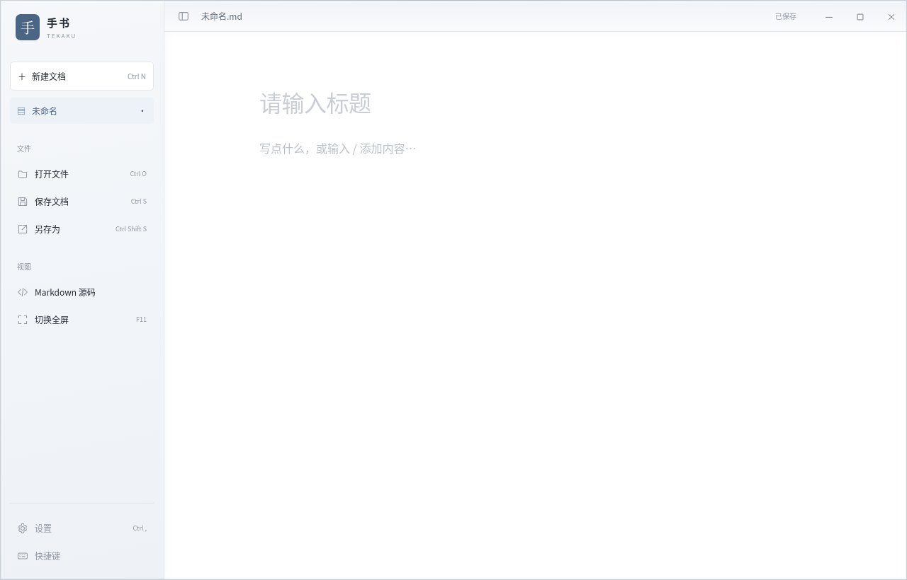
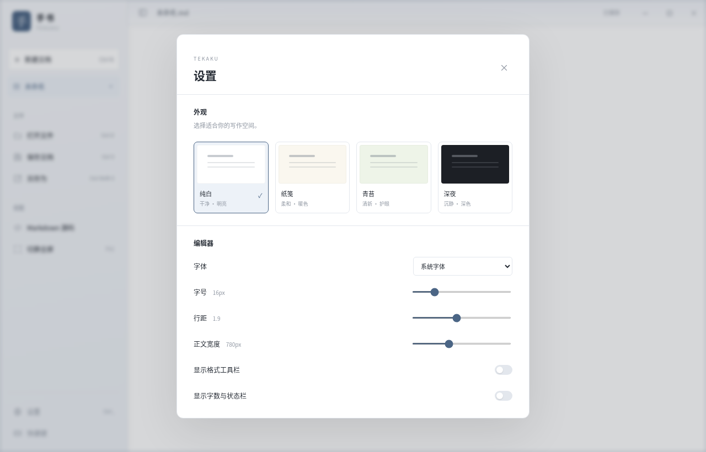

# 手书 Tekaku 0.4.0 · Windows 便携版

[下载 Windows x64 便携包（约 1.5 MiB）](https://github.com/Linkyyy/tekaku/raw/refs/heads/downloads/windows-v0.4.0/Tekaku-0.4.0-windows-x64.zip)

解压后运行 Tekaku.exe。支持 Windows 10/11 x64，需要 Microsoft Edge WebView2 Evergreen Runtime。程序本体约 3.65 MiB，无需安装 Go、Node.js 或 .NET。

## 本次更新

- 设置、打开、保存、另存为、源码、全屏和快捷键入口全部移入侧栏。点击左上角展开侧栏；Ctrl+, 仍可直接打开设置。
- 顶栏仅保留文件信息、侧栏开关与窗口控制，移除重复的专注模式。
- 增加随皮肤变化的细描边和顶栏渐变；窗口模式启用 Windows DWM 阴影和系统支持的圆角，全屏/最大化不保留外部阴影边距。
- 修复取消保存后立即再次关闭，确认弹窗可能不再次出现的问题；保存失败仍保留文档。

默认全屏、收起侧栏、白色皮肤。F11 切换全屏，Esc 退出；Ctrl+S 保存。原有四种皮肤、字体、字号、行距、正文宽度和工具栏设置保持可用。

侧栏、设置、文件操作、嵌入页面与保存确认等回归已验证；Windows 交叉编译通过。系统外部阴影效果仍需 Windows 实机确认，受桌面合成与系统设置影响。本构建未签名。

## 界面预览

## 校验

使用 PowerShell：`Get-FileHash .\Tekaku-0.4.0-windows-x64.zip -Algorithm SHA256`，应与 SHA256SUMS.txt 一致。
