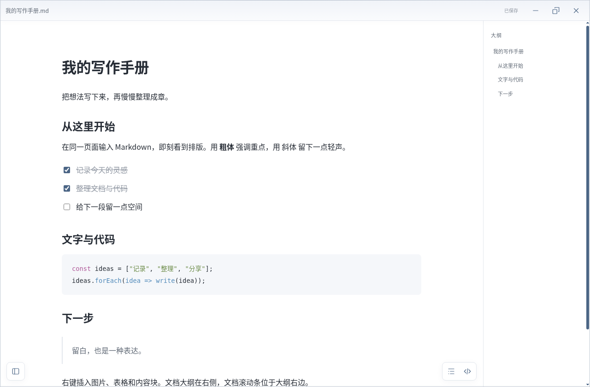
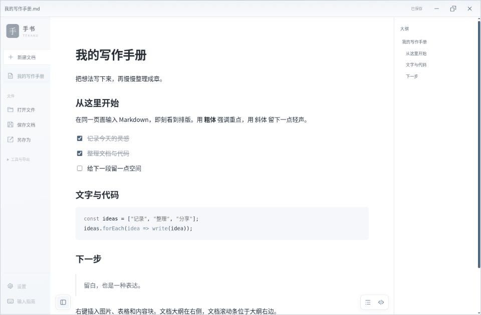
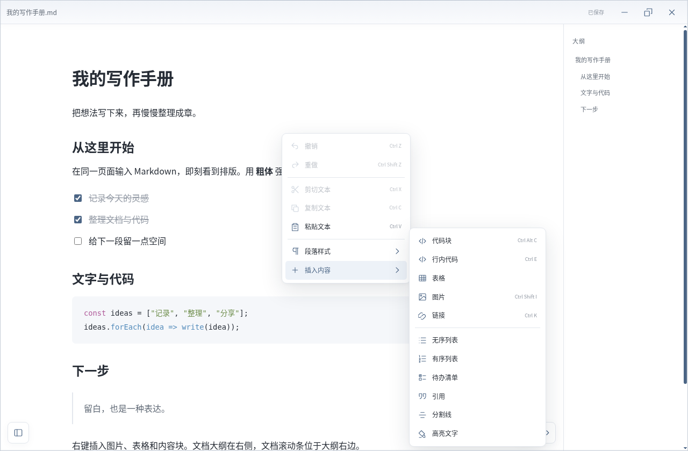
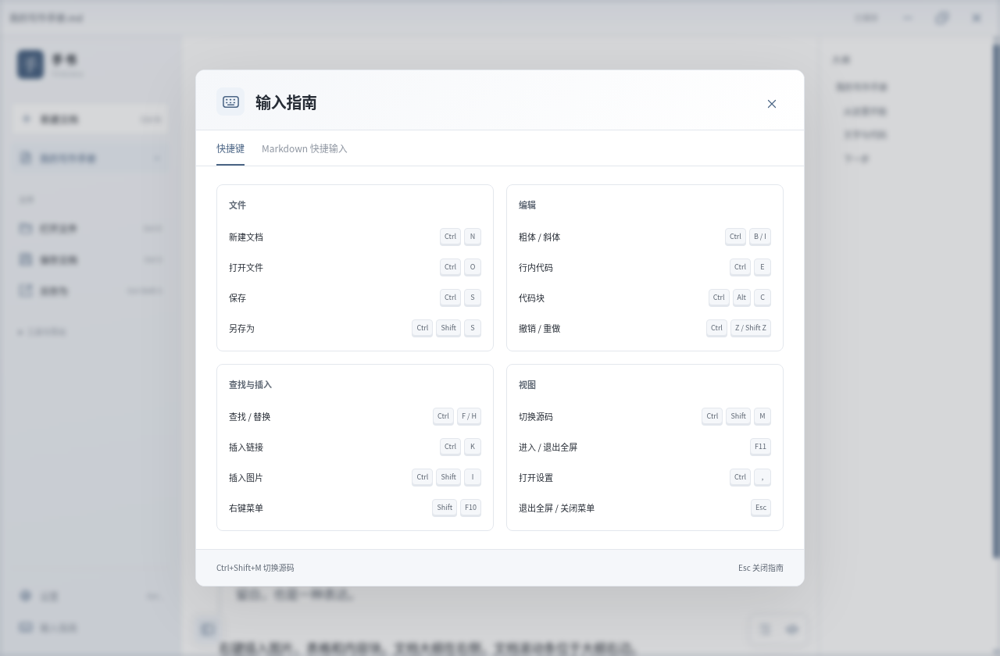
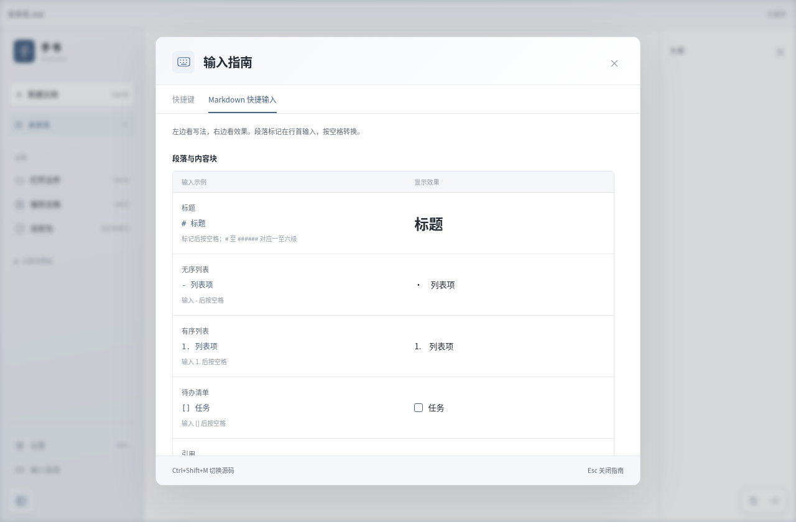
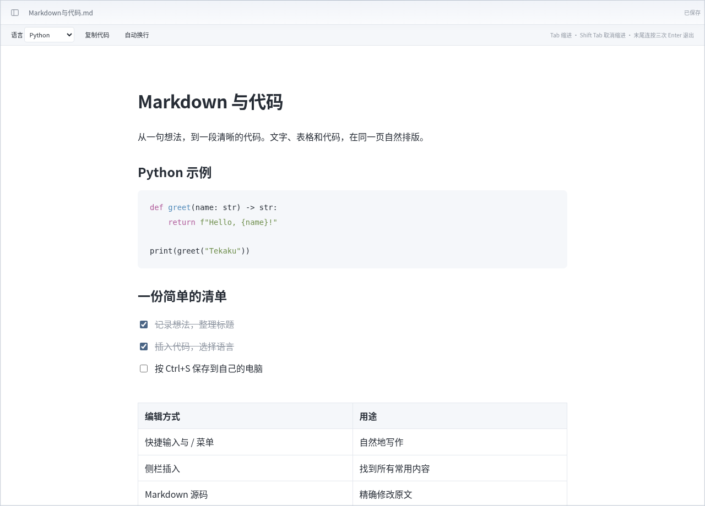
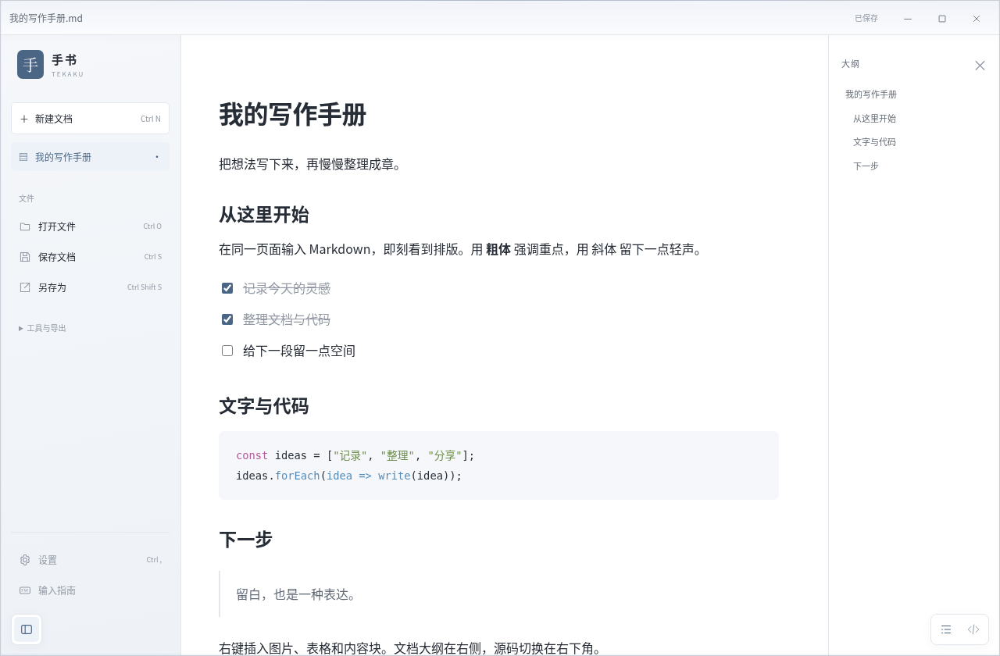

# 手书 · Tekaku

一个简洁、离线优先的 Markdown 编辑器，提供 Windows 桌面版和 Android 手机版。Typora 风格的安静界面，Notion 风格的内容块输入，在同一区域编辑与呈现。

[下载 Windows 0.11.1](https://github.com/Linkyyy/tekaku/raw/refs/heads/downloads/windows-v0.11.1/Tekaku-0.11.1-windows-x64.zip) · [下载 Android 0.1.0 APK](https://github.com/Linkyyy/tekaku/raw/refs/heads/downloads/android-v0.1.0/Tekaku-0.1.0-android.apk) · [官网源码](https://github.com/Linkyyy/tekaku/tree/gh-pages)

> **安全核查未结束：** 下载入口已恢复，但此前“检测到病毒”的报告仍缺少威胁名称及涉事版本。0.11.1 是功能修复，不能据此认定安全拦截已解决；EXE 仍未签名。若被拦截，请保留防护，不要加白名单。[核查记录](docs/SECURITY-ALERT-0.10.md)。



## 0.11.1：外部文件复用同一窗口

- 从资源管理器双击 Markdown、使用“打开方式”、拖文件到程序图标或再次启动程序时，转交给当前用户、当前登录会话中已有的手书窗口。
- 新文件添加为原窗口的 Tab；已打开路径切回已有标签，保留未保存的修改。
- 第二次启动只转交路径并退出，不创建 WebView2 或编辑器窗口；原窗口最小化时尝试恢复并激活。
- 编辑器尚未就绪时排队接收文件；保存确认等弹窗打开期间，延后切换文档。
- 初次启动支持接收全部文件参数；窗口繁忙或请求失败时提示重试，不擅自创建第二个编辑器窗口。

升级时请先完全退出 0.11.0 及更早版本，再启动新版一次。旧版没有单实例接收逻辑，不能接收本版的转交请求。

[本版检查](docs/RELEASE-CHECK-0.11.1.md)

## 0.11 桌面更新

- 顶栏与文件标签合成一行；去掉多余顶部高光和原生内边缘，只绘制一层客户端边框，窗口阴影保留。
- 工作区固定在窗口视口内，全屏和最大化保留内容区的侧栏、大纲、源码浮动按钮；侧栏可正常展开与收起。
- 新增灰蓝皮肤并设为新用户及重置设置后的默认皮肤；保留原来的纯白、纸笺、青苔和深夜。
- 支持多文件 Tab：Ctrl+O 文件选择器可多选，拖入多个 Markdown 也会分别打开标签。已打开的原生路径再次打开时切换到已有标签。
- 标签分别保留内容、修改状态、富文本撤销记录、源码/预览状态与滚动位置。关闭修改过的标签时询问保存；退出程序会逐个检查未保存标签。
- Ctrl+N 新建标签，Ctrl+W 关闭当前标签，Ctrl+Tab / Ctrl+Shift+Tab 切换标签；标签栏支持滚动与键盘方向键。
- 保存和相对图片解析显式使用各自标签的文件路径，避免打开其他文件后误存到另一个文档。
- 官网标识改为与程序相同的蓝色图标，网站配色与默认预览改为灰蓝，恢复 Windows 下载入口并保留安全核查提示。

Android 仍为 0.1.0，本次不修改 APK。

[本版检查](docs/RELEASE-CHECK-0.11.md)

## 0.10 桌面更新

- 仅文档内容保留可见滚动条，位于大纲右侧的工作区最右边；侧栏、大纲、设置、指南和菜单隐藏滚动条但仍可滚动。
- 左右悬浮按钮归属内容区域，侧栏打开后随内容区移动；全屏、最大化和窗口模式均可使用。
- 侧栏与大纲使用宽度滑入动画，默认开启，设置中可关闭。大纲移除关闭按钮，再点大纲悬浮按钮收起。
- 应用内按钮、格式工具、斜杠菜单、右键菜单统一使用蓝色 SVG 图标；EXE 和任务栏图标也改为蓝色。
- Windows 窗口保留真实、按 DPI 缩放的原生缩放边缘；客户端边缘和顶栏使用 SC_SIZE / SC_MOVE 及真实鼠标坐标。还原时恢复窗口样式，系统窗口状态变化同步界面；最小尺寸不超过显示器工作区。
- Android 保持 0.1.0。



## 0.9 桌面更新

- 输入指南分为快捷键与 Markdown 快捷输入页签；输入示例、操作提示与显示效果对照，标题、页签和关闭按钮固定。
- 应用标题栏独立固定；预览滚动条位于编辑区域右侧，大纲、侧栏、设置和弹窗各自滚动内容。
- 左侧栏开关移到左下角悬浮；侧栏和大纲支持展开/收起动画，尊重系统减少动态效果的设置。
- 源码与预览在同一编辑视口切换，去掉源码框的独立高度和缩放柄；分别保留滚动位置，源码/预览图标居中对齐。
- Android 仍为 0.1.0，本次只更新 PC。

## 0.8 桌面更新

- 大纲移到右侧独立栏，可收起并记住状态；源码改为右下角图标切换。左侧栏去掉源码、全屏和插入菜单。
- 编辑区提供分组右键菜单：编辑操作、正文/一至六级标题、图片、代码、表格、链接、列表等。支持 Shift+F10 和方向键；源码视图也能插入 Markdown。
- 添加多尺寸 EXE / 任务栏图标、应用标识和版本资源；首次启动加入当前用户的 Markdown“打开方式”。设置可添加/移除关联，不更改系统默认应用。移动便携程序后重新运行可更新路径。
- 全屏时移除隐藏的 Windows 缩放边框，为关闭按钮保留边距；快捷键指南改为分组卡片与按键样式。
- 打开/新建文档时重置撤销记录，避免撤销跨越文档边界。
- Android 仍为 0.1.0，本次只更新 PC。

## 0.7 与 Android 0.1

- Windows：窗口模式支持从四边、四角启动系统原生缩放；全屏与最大化时隐藏缩放区域。支持把 Markdown 直接拖入软件界面，确认未保存修改后导入；首次保存选择位置，避免覆盖前一个文件。
- 修复连续关闭确认可能收到上一次弹窗 close 事件的问题；代码中 Home / End 直接按逻辑行移动，避免撤销后快速移动光标时出现选区不同步。
- 新增 Android APK，约 235 KB，使用系统 WebView；支持系统文件选择器、打开方式/分享入口、保存与另存为、私有草稿、写入前副本、四种皮肤和 Markdown 源码。详见 [Android 使用与构建说明](docs/ANDROID.md)。
- Android 原生文件授权与文件读写需要真机复核；下载体积不代表运行内存。

## 0.6 更新

- 完善常用 Markdown 的多种输入方式：快捷输入、斜杠菜单、侧栏插入及源码编辑；支持一至六级标题、行内代码、代码块、列表、待办、引用和分割线。详见 [Markdown 编辑指南](docs/MARKDOWN.md)。
- 代码语言扩充至 26 项（含纯文本），增加 C/C++/C#、Java、Rust、PHP、Ruby、Swift、Kotlin、Dart、YAML、INI/TOML、PowerShell、Diff 与 Dockerfile。保留未知语言内容和围栏标签。
- 代码块与源码支持 Tab / Shift+Tab 缩进、整行多选缩进与撤销；列表支持层级调整。代码工具提供复制和自动换行；代码中的反引号围栏可安全往返保存。
- 移除 go-winloader 内存 PE 加载依赖，改为加载程序旁的 SDK WebView2Loader.dll；使用绝对路径、限制 DLL 搜索范围，并在加载前校验固定 SHA-256。
- 发布安全检查记录、校验值与可复核源码。用户提供的提示为“下载不常见”，属于下载信誉提示；当前 EXE 仍未签名，不能承诺此提示消失。









[安全检查记录与边界](docs/SECURITY-CHECK.md)

## 0.5 更新

- 图片：本地选择、多图拖入、剪贴板粘贴、网络地址、文档目录内相对路径；可编辑替代文字/说明和删除。支持 PNG、JPEG、GIF、WebP、BMP、SVG、AVIF，单图上限 5 MiB。
- 新插入图片在桌面端保存时提取到 `<文档名>.assets/`，按内容去重。另存为到其他目录会复制相对图片；遇到目标目录同名不同内容的图片会报错，不覆盖用户文件。移动文档时请一并携带附件目录。
- GFM 表格：插入表格、添加/删除行列、切换表头、调整列宽；Markdown 保存表格内容，列宽属于界面布局，不写入 GFM。
- 链接文字/地址编辑、打开网页与邮件链接；代码块语言选择和常用语言高亮；文字高亮。
- 查找替换支持大小写选项、上/下匹配、单次/全部替换和源码模式；显示文档标题大纲，点击定位。
- 导出 HTML（本地图片内嵌）、打印/PDF（系统打印对话框），打印时隐藏界面菜单并使用白底。
- 新入口放在侧栏的“插入”“工具与导出”中；图片/表格/代码操作栏仅在选中对应内容时出现。


## 0.4 更新

- 设置、打开/保存/另存为、源码、全屏和快捷键入口全部集中在侧边栏；顶栏只保留文件信息、侧栏开关与窗口控制。
- 完整移除专注模式，侧栏收起和全屏各自保留一个入口。
- 修复取消保存后立即再次关闭时，确认弹窗可能不再次出现的问题；保存失败仍保留编辑内容。
- 皮肤同步应用到外框描边、顶栏渐变及侧栏明暗；窗口模式启用 Windows DWM 阴影和圆角（系统支持时）。最大化与全屏不保留外部圆角和阴影边距。
- Windows 不支持的新 DWM 属性不会阻止运行；页面内部的细描边和渐变仍保留。系统外部阴影需 Windows 实机验证。



## 0.3 更新

- 移除系统标题栏，加入融入皮肤的自定义窗口控制；可拖动标题区、最小化、最大化/还原、关闭。
- 默认全屏，F11 切换、Esc 退出；默认收起侧栏，隐藏格式工具栏和状态栏。
- 新建文档自动提供空标题和正文，显示“请输入标题”；提示文字不写入 Markdown，不改动已导入的文档。
- 设置（齿轮或 Ctrl+,）支持灰蓝、纯白、纸笺、青苔、深夜五种皮肤；默认灰蓝。
- 可调整字体、字号、行距、正文宽度、工具栏/状态栏显示、启动全屏及侧栏状态，自动保存在本机。
- 应用内未保存确认和错误提示使用统一的主题弹窗；取消保存会保留当前文档。系统文件选择器仍使用 Windows 原生界面。

## Windows 使用

下载便携 ZIP 并完整解压，保留 `Tekaku.exe` 和 `WebView2Loader.dll` 在同一目录，双击 EXE 运行。无需安装 Go、Node.js 或 .NET。支持 **Windows 10/11 x64**，依赖系统的 [Microsoft Edge WebView2 Evergreen Runtime](https://developer.microsoft.com/microsoft-edge/webview2/)（Windows 11 通常已自带）。应用不打包 Chromium，也不启动 Node.js 或本地 HTTP 服务。

- `Ctrl+O` 打开本地文件；`Ctrl+S` 保存；`Ctrl+Shift+S` 另存为。
- `Ctrl+N` 新建；关闭窗口、打开其他文件或新建前会提示保存、不保存或取消。
- 可把 `.md` 文件拖到 **Tekaku.exe 图标**，或在 Windows“打开方式”中选择它。
- `# `、`## `、`- `、`1. `、`> `、`[] `、三个反引号加空格自动转换对应内容块。
- 空段落输入 `/`，用方向键和回车选择内容块。
- `Ctrl+B / I / Z` 粗体 / 斜体 / 撤销；`Ctrl+Shift+M` 在同一区域切换 Markdown 源码。
- 左下角悬浮按钮展开侧栏后可打开设置、文件操作、工具导出和输入指南；Ctrl+, 也可直接打开设置。
- 大纲位于右侧，源码使用右下角 </> 图标或 Ctrl+Shift+M 切换；F11 / Esc 切换和退出全屏。
- 编辑区右键或 Shift+F10 打开编辑与插入菜单；源码视图同样支持常用 Markdown 插入。
- 首次启动会加入当前用户 .md / .markdown 的“打开方式”；设置中可添加或移除，默认应用由 Windows 设置选择。

原生文件选择器和保存窗口使用 Windows API。保存先写同目录临时文件再替换目标；失败会显示错误并清理临时文件。支持 UTF-8（含 BOM），为控制大文件编辑时的资源占用，单文件上限为 **8 MiB**。

草稿与设置位于 `%APPDATA%\Tekaku\preferences.json`；WebView2 的运行数据位于同目录 `WebView2/`。草稿在停顿约 600ms 后合并写入，失焦也会触发写入。草稿不是原文件，修改后仍需 `Ctrl+S`。新版本草稿记录原文件路径，恢复后可继续保存原文件，并从同一目录显示本地图片。应用不会上传文档；当前不支持多窗口同时编辑。

## 轻量化

0.2 版用 **Go + 系统 WebView2** 替换 Electron，前端仍使用 Tiptap / ProseMirror：

- 删除 Electron、electron-builder 和相关开发辅助依赖。
- 编辑界面打包进 `.exe`，不携带完整浏览器；0.6 起随包附带原始 SDK 加载器 DLL，使用 Windows 常规加载机制。
- 每次输入只做必要更新；草稿写入防抖，移动光标不重新统计全文。
- 撤销历史保留 40 组；不编辑源码时避免重复解析文档，退出源码时释放文本缓冲。

**文件体积不等于内存。** 系统 WebView2 仍会创建浏览器子进程；运行内存应合计 Tekaku.exe 及其 msedgewebview2.exe 进程树，并受文档规模、WebView2 版本影响。本 Linux 云环境完成交叉编译和下述测试，尚未进行 Windows 实机启动、中文输入法与内存实测。

## 开发和构建

需要 Node.js 24 与 Go 1.27.3（见 `native/go.mod`）。已锁定 npm 与 Go 依赖，Go 保留官方模块校验。

```sh
npm ci
npm run dev
```

浏览器模式用于编辑器开发，通过文件选择器导入，保存时下载 `.md`，草稿使用浏览器本地存储。Windows 原生版使用受限的 RPC 桥接和本地设置文件。

```sh
npm run package:windows
```

可在 Linux 或 Windows 上交叉构建 Windows x64，无需 C 编译器。首次构建会安装固定版本 go-winres v0.3.3 生成图标、版本与 DPI 清单资源（构建工具，不随包运行）；可通过 TEKAKU_WINRES 指定已有工具。输出 `release/windows/Tekaku.exe`、`WebView2Loader.dll`、`SHA256SUMS.txt` 和使用说明。Windows 上 `npm run desktop` 会构建并启动，`npm start` 启动已有构建。当前没有代码签名，SmartScreen 可能显示未知发布者。

云机器指定工具与缓存：

```sh
export TEKAKU_GO=/workspace/.tools/go/bin/go
export GOPATH=/workspace/.go
export GOCACHE=/workspace/.cache/go-build
export GOPROXY=https://proxy.golang.org
export npm_config_cache=/workspace/.npm
npm run package:windows
```

构建脚本将 Vite 输出内联为单个 HTML，再通过 Go embed 嵌入程序；运行时无需本地服务器。网络图片需要网络访问；文档内容不会上传。页面 CSP 限制脚本与连接，允许图片资源；链接通过用户主动点击后交给系统浏览器。原生文件路径来自用户选择、启动参数或已保存的恢复信息；相对图片仅从文档目录内解析。

## 验证

```sh
npx playwright install chromium
npm test
npm run test:native
```

已有 Chromium 可用 `TEKAKU_CHROMIUM=/usr/bin/chromium npm test`。55 项桌面界面测试覆盖极简首页、标题占位符、实时编辑、Markdown 转换、导入导出、草稿、源码查看、皮肤和设置持久化、嵌入页面、无 localStorage 桥接、窗口控制协议、自定义保存/关闭弹窗、侧栏文件菜单、右侧大纲、右下角源码、右键编辑/插入、纯文本剪贴板、文件关联协议、分组快捷键、Markdown 示例对照、固定标题与独立滚动、源码视口尺寸与图标对齐、面板切换、动画开关和多 DPI 页面边界、图文表格、搜索替换、HTML/打印输出和写入错误，以及完整标题层级、代码围栏、语言别名、缩进撤销、代码复制换行和列表层级。12 项 Go 测试覆盖 UTF-8/BOM、大文件保护、临时文件清理、覆盖保存和草稿设置读写、图片提取去重、相对图解析、另存为复制、代码示例保留、路径边界与文件关联注册计划。Windows GUI、任务栏/资源管理器图标、真实注册表关联、多显示器全屏/DPI、常规 DLL 加载和 Win32 对话框需在实机复核；浏览器桥接测试使用模拟原生接口，不代替实机测试。当前还验证了滚动条位于大纲右侧并控制两种视图、隐藏滚动条后仍可滚动、全屏悬浮按钮命中、面板动画的中间宽度，以及真实鼠标操作触发八向缩放协议。Go 测试增加了系统缩放方向、负屏幕坐标与 DPI / 全屏最小尺寸约束。

## 支持范围

标题、段落、粗体、斜体、删除线、链接、图片、表格、高亮、行内代码、代码块、有序/无序列表、嵌套列表、待办、引用和分割线。代码语言详见 [Markdown 编辑指南](docs/MARKDOWN.md)；其他语言的代码内容会保留。

尚未加入公式排版、Mermaid 渲染、脚注和 YAML front matter 专用编辑，不能声称覆盖所有 Markdown 扩展。导入导出会规范化 Markdown 格式，复杂文档请先另存为。浏览器模式选择的图片保存在 Markdown 的 data URI 中；桌面模式保存时写出附件。未解析的相对图片不会被悄悄删除，编辑器会显示读取失败；父目录和文档目录外的图片请用“选择本地图片”重新插入。搜索最多处理 10000 个匹配，更多匹配时需缩小范围再替换。HTML 导出会内嵌可读取的本地图片；网络图片保留原地址。Windows 的文件、链接和打印对话框仍需实机复核。

