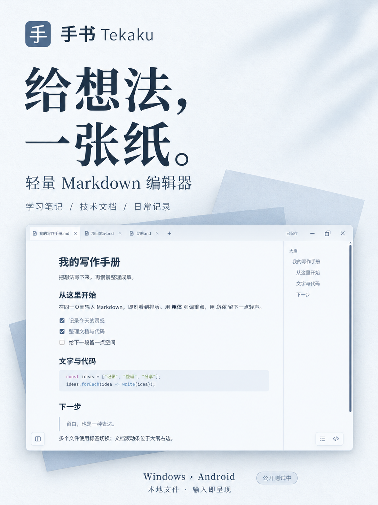

# 手书 Tekaku 宣传素材包

学生笔记与程序员文档两个场景，共用灰蓝色的品牌设计。制作日期：2026-10-30。

[下载整套 ZIP](https://github.com/Linkyyy/tekaku/archive/refs/heads/marketing/2026-10-30.zip) · [查看全部图片](images) · [可直接发布的文案](copy/02-可直接发布的文案.md)

## 里面有什么

- 6 张 3:4 竖版 PNG（1086 × 1448），用于图文轮播、动态或海报。
- 1 张横版 PNG（1672 × 941，接近 16:9），用于视频封面或文章头图；按平台上传提示做极小幅裁切即可。
- 4 份可编辑 Markdown 文案：产品定位与平台建议、各平台发帖文案、90 秒及 30 秒视频脚本、卖点事实表。
- 原始界面截图与程序图标，便于配合真实操作说明使用。
- `index.html` 离线图片总览：下载解压后直接用浏览器打开。

图片为成品 PNG，不包含分层 PSD 或 Figma 文件。可以修改配套 Markdown 文案；需要改图片文字时，可用原图继续编辑。

## 推荐怎么发

小红书首发图序：01 → 02 → 03 → 04 → 05 → 06。

B站：07 作封面，功能过程用真实编辑录屏。

V2EX、掘金、少数派：从具体场景或实现取舍出发，使用配套作者分享文案，不伪装成第三方测评。

推广优先顺序建议：小红书 / B站展示体验，V2EX 收集早期反馈，GitHub 承接说明；随后做掘金、少数派长内容。Android 可以在酷安单独介绍。

## 下载与阅读

- [01-品牌主视觉.png](images/01-%E5%93%81%E7%89%8C%E4%B8%BB%E8%A7%86%E8%A7%89.png)：给想法，一张纸。
- [02-输入即呈现.png](images/02-%E8%BE%93%E5%85%A5%E5%8D%B3%E5%91%88%E7%8E%B0.png)：写下，即呈现。
- [03-多文件Tab.png](images/03-%E5%A4%9A%E6%96%87%E4%BB%B6Tab.png)：多份文档，一个窗口。
- [04-代码与笔记.png](images/04-%E4%BB%A3%E7%A0%81%E4%B8%8E%E7%AC%94%E8%AE%B0.png)：笔记里，也放得下代码。
- [05-Android手机版.png](images/05-Android%E6%89%8B%E6%9C%BA%E7%89%88.png)：灵感来了，手机也能写。
- [06-轻量下载包.png](images/06-%E8%BD%BB%E9%87%8F%E4%B8%8B%E8%BD%BD%E5%8C%85.png)：轻一点，写多一点。
- [07-横版视频封面.png](images/07-%E6%A8%AA%E7%89%88%E8%A7%86%E9%A2%91%E5%B0%81%E9%9D%A2.png)：一款安静的 Markdown 编辑器

- [01-定位与平台建议](copy/01-%E5%AE%9A%E4%BD%8D%E4%B8%8E%E5%B9%B3%E5%8F%B0%E5%BB%BA%E8%AE%AE.md)
- [02-可直接发布的文案](copy/02-%E5%8F%AF%E7%9B%B4%E6%8E%A5%E5%8F%91%E5%B8%83%E7%9A%84%E6%96%87%E6%A1%88.md)
- [03-视频脚本与发布顺序](copy/03-%E8%A7%86%E9%A2%91%E8%84%9A%E6%9C%AC%E4%B8%8E%E5%8F%91%E5%B8%83%E9%A1%BA%E5%BA%8F.md)
- [04-卖点事实表与使用边界](copy/04-%E5%8D%96%E7%82%B9%E4%BA%8B%E5%AE%9E%E8%A1%A8%E4%B8%8E%E4%BD%BF%E7%94%A8%E8%BE%B9%E7%95%8C.md)

## 发布前知道的事实

这套海报是基于产品截图生成的 AI 辅助宣传设计；小字与界面细节可能存在重绘差异，不作为功能、性能或 Windows 实机测试的证据。`original-screenshots/` 中是未经宣传排版的前端界面素材，来自浏览器渲染；也不能写成 Windows 原生行为实机验证。发布时按平台要求标注 AI 辅助内容。

Windows ZIP 约 1.9 MB 指下载体积，不是运行内存，且需系统 WebView2。Android APK 约 235 KB，依赖系统 WebView。手机与电脑各自使用本地文件，暂无自动同步。多文件 Tab 等桌面特性不应直接套用到 Android。

当前 Windows 安全拦截报告仍未查明；先做自然展示与小范围公开测试，不把本素材的生成当作扩大付费下载投放的依据。不要写“病毒误报已解决”“安全无毒”或“秒开/几乎不占内存”。

项目与支持范围：https://github.com/Linkyyy/tekaku

安全核查：https://github.com/Linkyyy/tekaku/blob/main/docs/SECURITY-ALERT-0.10.md

本素材包不包含安装包或软件二进制，也没有代用户向社交平台发布内容。
